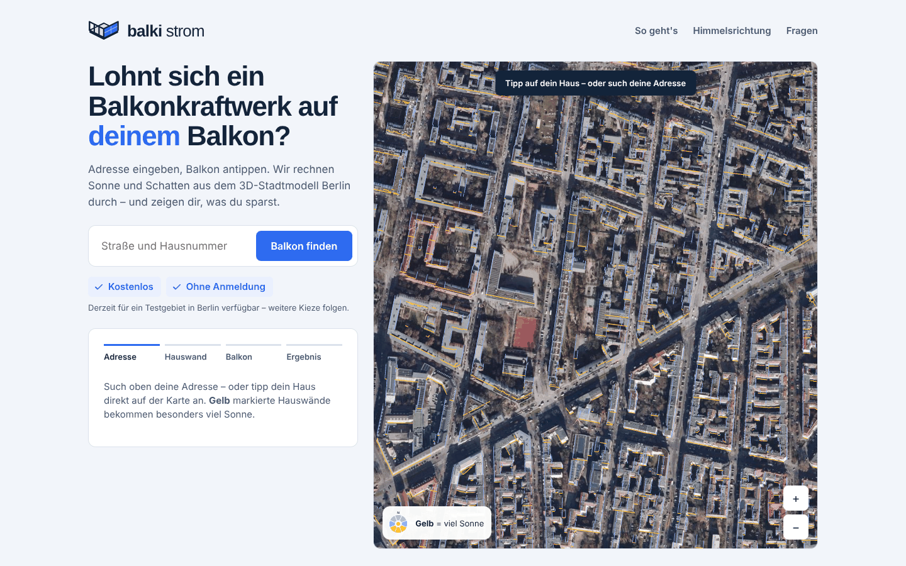
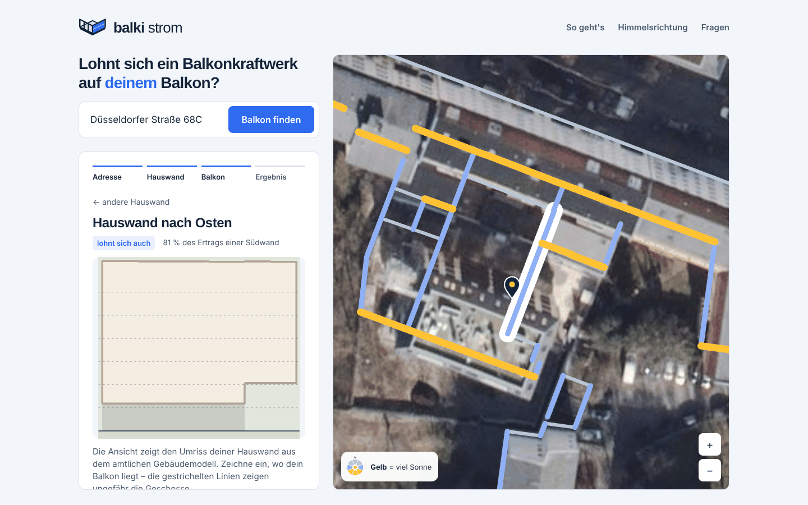
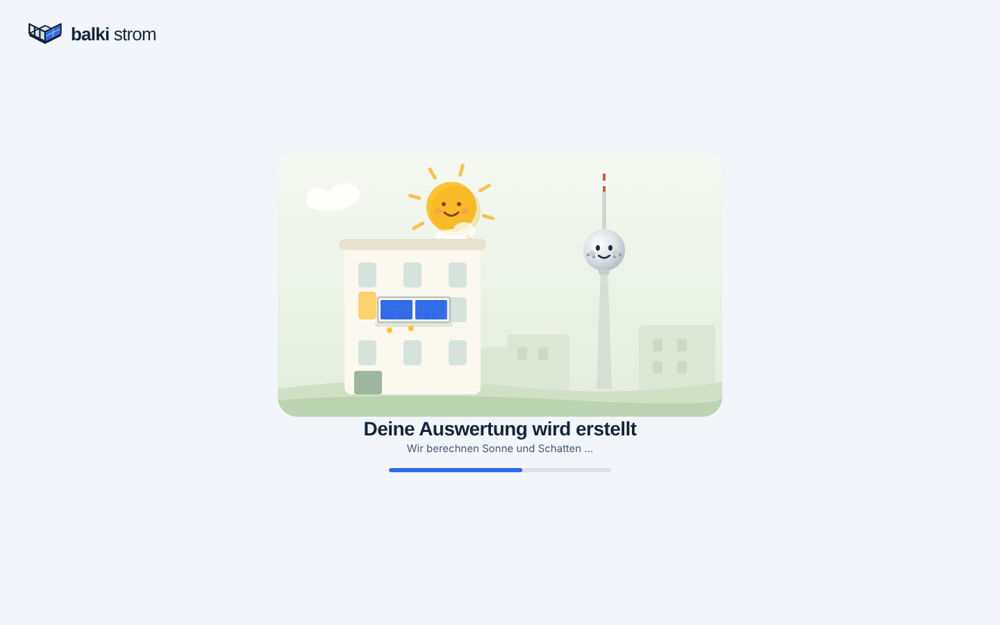
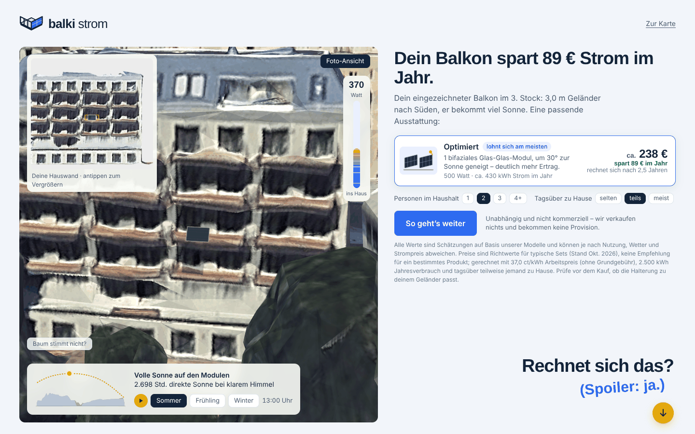

> [!IMPORTANT]
> **Hinweis: Neuere Version verfügbar (`balki_strom`)**
> 
> Dieses Repository dokumentiert die erste Entwicklungsstufe mit **KI-gestützter Fassaden- und Balkonerkennung über die Claude API (Anthropic)** sowie den Vergleich zwischen 3D-Mesh und offenen LoD2-Geodaten.
> 
> Die **aktuelle, nicht-kommerzielle und datensparsame Version** (direkte Auswahl im fototexturierten 3D-Stadtmodell, komplett ohne externe API-Abhängigkeiten und unter GNU AGPL-3.0) wird hier aktiv weiterentwickelt:  
> 👉 **[github.com/janhh011/balki_strom](https://github.com/janhh011/balki_strom)**

---

# Balki-Strom

Ein kostenloser, nicht-kommerzieller Sonnen-Check für Berliner Balkone: Adresse eingeben, Balkon wählen und sehen, ob sich dort ein Balkonkraftwerk lohnt – berechnet aus dem 3D-Stadtmodell von Berlin, mit Verschattung durch Nachbarhäuser und Bäume über das ganze Jahr.

> **Nicht kommerziell.** Keine Werbung, keine Partnerlinks, keine Provision, kein Verkauf von Daten oder Kontakten. Die Ausstattungen sind neutrale Beispiele mit Richtpreisen, ohne Marken oder Shop. Ein privates Studierendenprojekt, derzeit ohne Einnahmen.

<p align="center">
  
  
</p>
<p align="center">
  
  
</p>
<p align="center"><sub>Adresse suchen → Hauswand wählen und Balkon einzeichnen → Auswertung wird erstellt → Ergebnis mit Foto-Ansicht, Sonnenverlauf und Ersparnis</sub></p>

## Ablauf

1. **Fassaden** – aus einer Mesh-Kachel werden Gebäudeumrisse abgeleitet, jede Wand bekommt ihre Himmelsrichtung und eine Frontalansicht.
2. **Balkone** – Claude markiert Balkone und Loggien per Batch API; Maße kommen aus dem Bildmaßstab.
3. **Sonne und Schatten** – für jeden Modulpunkt wird der Horizont aus Nachbarhäusern und Bäumen vermessen und der Ertrag stündlich über ein Jahr simuliert (pvlib). Den Eigenverbrauch rechnet ein minutengenaues Haushaltsmodell (Grundlast, Geräte zu typischen Zeiten, tagsüber zu Hause oder nicht).
4. **Ergebnis** – Ertrag, Ersparnis und Amortisation für typische Ausstattungen (neutrale Richtpreise), dazu ein 3D-Hausmodell mit Sonnenverlauf und Live-Leistung sowie die nächsten Schritte mit Links zu unabhängiger Beratung.
5. **Nutzerseite** – Adresse eingeben, Hauswand wählen (Süd, Südost, Südwest hervorgehoben), Balkon antippen oder selbst einzeichnen. Claude sucht Balkone nur auf der Wand, die jemand anklickt; das Ergebnis wird für alle gespeichert. Der bisherige Fassaden-Explorer bleibt als internes Werkzeug (`intern.html`).

## Nutzung

```bash
pip3 install -r requirements.txt anthropic

# 1. Fassaden aus einer Kachel des Berlin 3D Downloadportals
python3 pipeline/fassaden_pipeline.py data/<kachel> webapp

# 2. Balkone erkennen (API-Key in .env: ANTHROPIC_API_KEY=...)
python3 pipeline/balkone_claude.py submit --classes S
python3 pipeline/balkone_claude.py collect

# 3. Ertrag simulieren und Ergebnisseiten erzeugen
python3 pipeline/angebot.py data/<kachel> webapp --alle-angebote

# 4. Adressen für die Suche (amtliche Hauskoordinaten Berlin)
python3 pipeline/adressen.py webapp

# 5. Webseite mit API starten (Balkonsuche auf Abruf, selbst einzeichnen)
python3 server/app.py data/<kachel> webapp --port 8000     # oder: webapp/start.command
```

### LoD2-Version (offene Daten, ohne Mesh)

Alle Quellen unter Datenlizenz Deutschland – Zero 2.0: LoD2-Gebäude für Häuser und Hauswände, bDOM 2026 für Bäume, Luftbild DOP20 2025 für Karte und Dächer. Die Hauswände haben eine schematische Ansicht (Umriss), Balkone zeichnet der Nutzer ein; die automatische Balkonsuche gibt es nur für Wände mit Foto.

```bash
# Gebiet in EPSG:25833 (Kern, Hauswände); 250 m Umgebung für Schatten werden automatisch mitgeladen
python3 pipeline/lod2_pipeline.py data/downloads webapp_lod2 --bbox 385500,5816800,386500,5817800
python3 pipeline/adressen.py webapp_lod2
# optional: Fassadenfotos aus einer Mesh-Kachel für die LoD2-Wände (Rückseiten werden verworfen)
python3 pipeline/mesh_fotos.py data/3858_58171_-002 webapp_lod2
python3 server/app.py data/3858_58171_-002 webapp_lod2 --port 8000   # erstes Argument: Mesh-Kachel (für Fotos) oder data/downloads

# Vergleich mit der Mesh-Version (gleiche Balkone, Ertrag je kWp)
python3 pipeline/vergleich_mesh_lod2.py webapp webapp_lod2
```

Rohdaten liegen unter `data/` (nicht im Repo):

```
data/
  3858_58171_-002/      Mesh-Testkachel (Berlin 3D, nur für Fassadenbilder)
  downloads/
    lod2/               LoD2-Gebäude, 1-km-Kacheln (pipeline/lod2_download.sh)
    luftbild/           Luftbilder DOP20 2025
    laserscan/          Laserscan (ALS)
    mesh/               weitere Mesh-Kacheln
```

Hosting, Sicherheit und Datenschutz: [docs/ARCHITEKTUR.md](docs/ARCHITEKTUR.md) · Offene Punkte: [docs/BACKLOG.md](docs/BACKLOG.md) · Styleguide: [docs/STYLEGUIDE.md](docs/STYLEGUIDE.md) ([PDF](docs/STYLEGUIDE_Solar-Blue.pdf))

## Daten und Lizenzen

- LoD2-Gebäude, bDOM, Luftbild DOP20, Hauskoordinaten: Geoportal Berlin, Datenlizenz Deutschland – Zero 2.0.
- 3D-Mesh (Fassadenfotos): Berlin 3D-Downloadportal; Nutzung hier ausschließlich nicht-kommerziell gemäß den Lizenzbedingungen des Anbieters.
- Balkonerkennung auf Fassadenbildern über die Claude API (Anthropic); es werden nur Fassadenbilder übertragen, keine Nutzerdaten.
- three.js (MIT), pvlib (BSD).

## Stand

- Eine Kachel in Berlin-Wilmersdorf: 95 Südfassaden ausgewertet, 111 Balkone mit Ergebnis.
- Wetter aus einem synthetischen Referenzjahr (PVGIS-TMY über `--wetter` einlesbar); Ertrag etwa ±15 %, Maße ±0,3–0,5 m.
- Preise sind Richtwerte für typische Sets (Stand Okt. 2026), keine Kaufempfehlung.
- LoD2-Version (Branch `main`): 1 km² Wilmersdorf in gut 1 Minute auf dem Mac, 4.685 Hauswände. Gegenüber der Mesh-Version (Branch `version/mesh-v1`) für 87 gleiche Balkone: Ertrag im Median +4 %, 74 % innerhalb ±20 %. Abweichungen vor allem im Erdgeschoss und 1. Stock (Bäume im unbelaubten bDOM schwächer erfasst).

## Warum ich das baue

Balkonkraftwerke sind günstig, legal und in einer Stunde montiert – trotzdem hat die Mehrheit keins. Meine Hypothese: Es scheitert selten an der Technik, sondern am Weg dorthin. Wer sich nicht für Solar interessiert, recherchiert weder Wattzahlen noch Halterungen oder Ausrichtung.

Deshalb drehe ich den Prozess um: Statt dass Menschen sich selbst einarbeiten müssen, rechnet die Software für ihren konkreten Balkon vor – Ausrichtung, Maße, Schatten und Ertrag. Die erste Frage „Lohnt sich das bei mir?“ soll in einer Minute beantwortet sein, unabhängig und ohne Verkaufsinteresse.

Mich interessiert dabei die übergeordnete Frage, wie sich KI und offene Geodaten nutzen lassen, um Hürden der Energiewende im Alltag abzubauen – gerade für Mieterinnen und Mieter, die sich bisher nicht mit dem Thema beschäftigt haben.

Das Projekt ist ein laufendes Experiment und kein fertiges Produkt. Feedback, Daten zur Validierung (gemessene Erträge) und Gespräche, etwa mit Initiativen und Bezirken, sind willkommen.

– Jan-Hendrik Höltkemeier · M.Sc. IMES, TU Berlin
