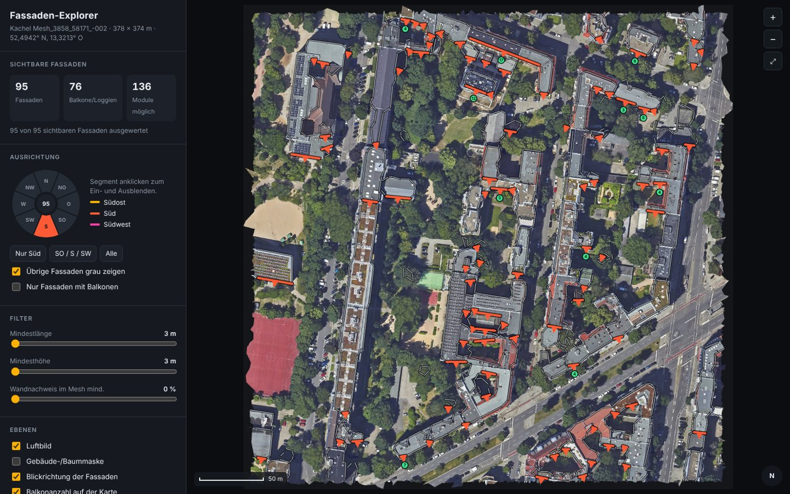
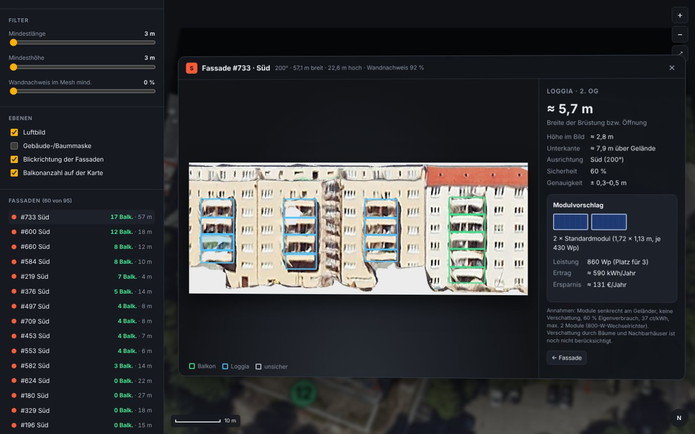
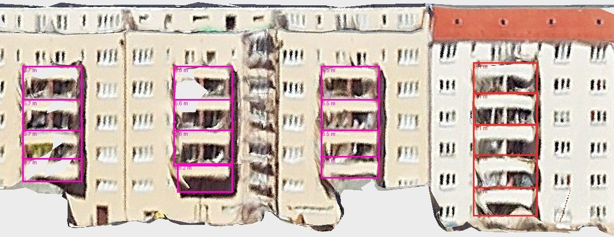

# bkw_finden

Findet Balkone mit Potenzial für Balkonkraftwerke – automatisch aus dem offenen 3D-Stadtmodell von Berlin.







## Ablauf

1. **Fassaden** – aus einer Mesh-Kachel werden Gebäudeumrisse und Höhensprünge abgeleitet, jede Wand bekommt ihre Himmelsrichtung.
2. **Frontalansichten** – je Fassade wird ein Bild aus dem Mesh gerendert, Bäume davor werden ausgeblendet.
3. **Balkone** – Claude markiert Balkone und Loggien per Batch API; Breite und Höhe werden aus dem Bildmaßstab berechnet.
4. **Webseite** – Karte, Filter nach Ausrichtung, Eintauch-Ansicht je Fassade mit Modulvorschlag und Ertragsschätzung.

## Nutzung

```bash
pip3 install -r requirements.txt anthropic

# 1. Fassaden aus einer Kachel des Berlin 3D Downloadportals
python3 pipeline/fassaden_pipeline.py data/<kachel> webapp

# 2. Balkone erkennen (API-Key in .env: ANTHROPIC_API_KEY=...)
python3 pipeline/balkone_claude.py submit --classes S
python3 pipeline/balkone_claude.py collect

# 3. Webseite starten
webapp/start.command
```

## Stand

- Eine Kachel in Berlin-Wilmersdorf, alle 95 Südfassaden ausgewertet (Sonnet 5.5, 0,26 $).
- Maße ±0,3–0,5 m. Ertrag ohne Verschattung – das ist der nächste Schritt.

## Warum ich das baue

Balkonkraftwerke sind günstig, legal und in einer Stunde montiert – trotzdem hat die Mehrheit keins. Meine Hypothese: Es scheitert selten an der Technik, sondern am Weg dorthin. Wer sich nicht für Solar interessiert, recherchiert weder Wattzahlen noch Halterungen oder Ausrichtung.

Deshalb drehe ich den Prozess um: Statt dass Menschen ein passendes Set suchen müssen, findet die Software den passenden Balkon. Ausrichtung, Maße und Ertrag sind schon berechnet, bevor jemand überhaupt fragt. Daraus entsteht ein individuelles Angebot für genau diesen Balkon, mit konkretem Modulvorschlag und einer Vorabrechnung, was es spart.

Parallel zu diesem Repo baue ich genau diese individualisierten Angebote. Mich interessiert dabei die übergeordnete Frage, wie sich KI und offene Daten nutzen lassen, um physische Produkte wie Solarmodule und Balkonkraftwerke vorab auf eine konkrete Person zuzuschneiden. So wird aus einem Standardprodukt ein Angebot, das man nicht mehr selbst recherchieren muss.

Das Projekt ist ein laufendes Experiment und kein fertiges Produkt. Feedback und Gespräche sind willkommen.

– Jan-Hendrik Höltkemeier · M.Sc. IMES, TU Berlin
