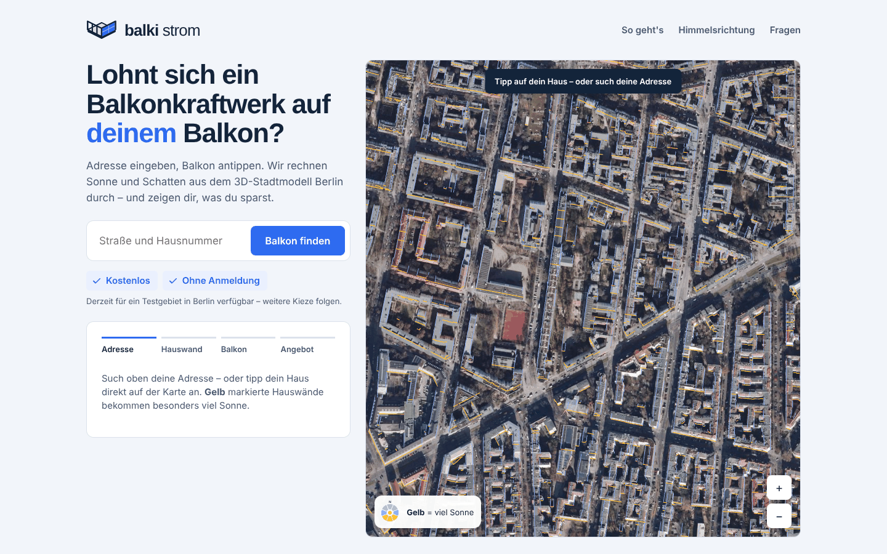
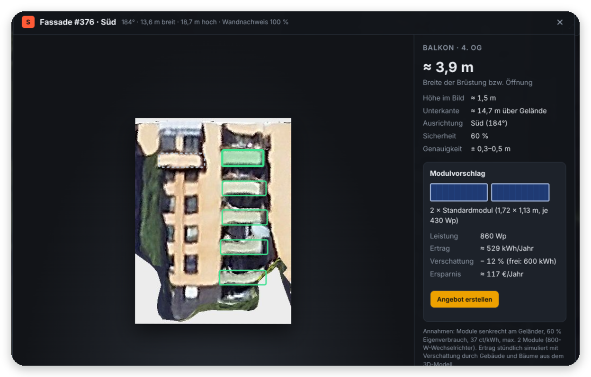
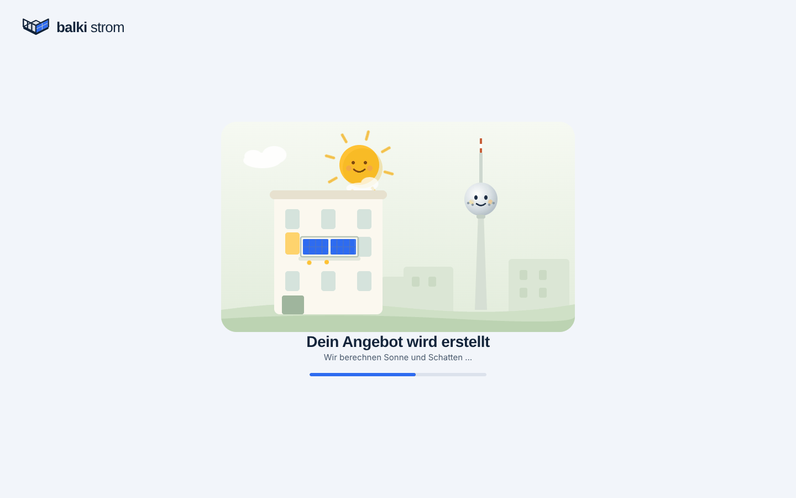
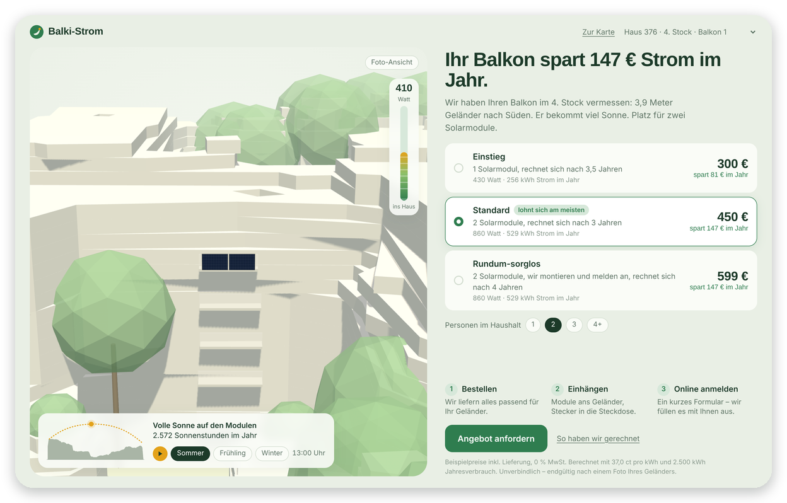

# Balki-Strom

Findet Balkone mit Potenzial für Balkonkraftwerke im 3D-Stadtmodell von Berlin und erstellt daraus ein persönliches Angebot – mit Verschattung, Preis und Amortisation.

<p align="center">
  
  
</p>
<p align="center">
  
  
</p>
<p align="center"><sub>Karte mit allen Südfassaden → Balkon wählen → Angebot wird erstellt → Angebot mit 3D-Modell, Sonnenstand und Preisen</sub></p>

## Ablauf

1. **Fassaden** – aus einer Mesh-Kachel werden Gebäudeumrisse abgeleitet, jede Wand bekommt ihre Himmelsrichtung und eine Frontalansicht.
2. **Balkone** – Claude markiert Balkone und Loggien per Batch API; Maße kommen aus dem Bildmaßstab.
3. **Sonne und Schatten** – für jeden Modulpunkt wird der Horizont aus Nachbarhäusern und Bäumen vermessen und der Ertrag stündlich über ein Jahr simuliert (pvlib). Den Eigenverbrauch rechnet ein minutengenaues Haushaltsmodell (Grundlast, Geräte zu typischen Zeiten, tagsüber zu Hause oder nicht).
4. **Angebot** – drei Ausstattungen mit Preis, Ersparnis und Amortisation, dazu ein 3D-Hausmodell mit Sonnenverlauf und Live-Leistung.
5. **Nutzerseite** – Adresse eingeben, Hauswand wählen (Süd, Südost, Südwest hervorgehoben), Balkon antippen oder selbst einzeichnen. Claude sucht Balkone nur auf der Wand, die jemand anklickt; das Ergebnis wird für alle gespeichert. Der bisherige Fassaden-Explorer bleibt als internes Werkzeug (`intern.html`).

## Nutzung

```bash
pip3 install -r requirements.txt anthropic

# 1. Fassaden aus einer Kachel des Berlin 3D Downloadportals
python3 pipeline/fassaden_pipeline.py data/<kachel> webapp

# 2. Balkone erkennen (API-Key in .env: ANTHROPIC_API_KEY=...)
python3 pipeline/balkone_claude.py submit --classes S
python3 pipeline/balkone_claude.py collect

# 3. Ertrag simulieren und Angebotsseiten erzeugen
python3 pipeline/angebot.py data/<kachel> webapp --alle-angebote

# 4. Adressen für die Suche (amtliche Hauskoordinaten Berlin)
python3 pipeline/adressen.py webapp

# 5. Webseite mit API starten (Balkonsuche auf Abruf, selbst einzeichnen)
python3 server/app.py data/<kachel> webapp --port 8000     # oder: webapp/start.command
```

Rohdaten liegen unter `data/` (nicht im Repo):

```
data/
  3858_58171_-002/      Mesh-Testkachel (Berlin 3D, nur für Fassadenbilder)
  downloads/
    lod2/               LoD2-Gebäude, 1-km-Kacheln (pipeline/lod2_download.sh)
    luftbild/           Luftbilder DOP20 2025
    laserscan/          Laserscan (ALS)
    mesh/               weitere Mesh-Kacheln
```

Partnerlinks (Provision beim Kauf) je Set in `pipeline/partner.json` eintragen; ohne Link sammelt der Knopf nur Anfragen.

Hosting, Sicherheit und Datenschutz: [docs/ARCHITEKTUR.md](docs/ARCHITEKTUR.md)

## Stand

- Eine Kachel in Berlin-Wilmersdorf: 95 Südfassaden ausgewertet, 111 Balkone mit Angebot.
- Wetter aus einem synthetischen Referenzjahr (PVGIS-TMY über `--wetter` einlesbar); Ertrag etwa ±15 %, Maße ±0,3–0,5 m.
- Preise sind Platzhalter.

## Warum ich das baue

Balkonkraftwerke sind günstig, legal und in einer Stunde montiert – trotzdem hat die Mehrheit keins. Meine Hypothese: Es scheitert selten an der Technik, sondern am Weg dorthin. Wer sich nicht für Solar interessiert, recherchiert weder Wattzahlen noch Halterungen oder Ausrichtung.

Deshalb drehe ich den Prozess um: Statt dass Menschen ein passendes Set suchen müssen, findet die Software den passenden Balkon. Ausrichtung, Maße und Ertrag sind schon berechnet, bevor jemand überhaupt fragt. Daraus entsteht ein individuelles Angebot für genau diesen Balkon, mit konkretem Modulvorschlag und einer Vorabrechnung, was es spart.

Parallel zu diesem Repo baue ich genau diese individualisierten Angebote. Mich interessiert dabei die übergeordnete Frage, wie sich KI und offene Daten nutzen lassen, um physische Produkte wie Solarmodule und Balkonkraftwerke vorab auf eine konkrete Person zuzuschneiden. So wird aus einem Standardprodukt ein Angebot, das man nicht mehr selbst recherchieren muss.

Das Projekt ist ein laufendes Experiment und kein fertiges Produkt. Feedback und Gespräche sind willkommen.

– Jan-Hendrik Höltkemeier · M.Sc. IMES, TU Berlin
